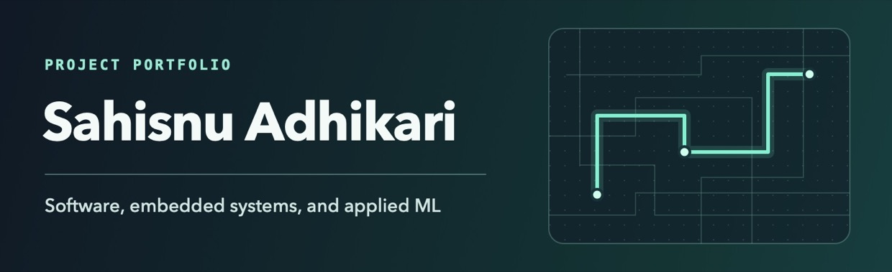

# 

I’m a high school developer in Houston. My projects range from a walking and biking navigation app to sensor dashboards and machine learning research. I put this portfolio together for the Stripe high school software engineering internship application.

[GitHub profile](https://github.com/Astros007) · [Personal portfolio](https://github.com/Astros007/sahiadhikari.me) · [All projects](#more-projects)

## Featured projects

### Safr
**JavaScript · Swift · OpenStreetMap · Valhalla**

A team-built navigation app for walking and biking. Safr scores street segments using factors such as road speed, crossings, sidewalks, and lighting. It shows the lowest-exposure route alongside the fastest route so users can see the trade-off before starting a trip.

[Source and setup](https://github.com/Astros007/Safr) · [Route safety tests](https://github.com/Astros007/Safr/blob/main/tests/safety.test.mjs)

### Clever Cardiacs
**JavaScript · HTML and CSS · micro:bit**

A browser dashboard for a pulse-monitoring prototype. I built two views for live readings and risk analysis, with a signal chart, heart-rate status, and BMI. The browser code shows how the dashboard turns readings into data people can interpret.

[Dashboard code](https://github.com/Astros007/sahiadhikari.me/blob/main/clever-cardiacs.html)

### Kidney CT Imaging Research
**Python · TensorFlow · Grad-CAM**

I developed a kidney tumor classification model that uses Grad-CAM heatmaps during training. The training objective encourages the model to rely on tumor features in CT scans and gives me a way to inspect where the model is looking.

[Research abstract](https://github.com/Astros007/sahiadhikari.me/blob/main/kidney-ct-scan-research-abstract.pdf)

## More projects

| Project | What I built | Explore |
| --- | --- | --- |
| **FitRank** | A social web app prototype that scores outfit photos and supports posting streaks and invite-only leaderboards. Built with JavaScript and Node.js. | Private source |
| **data** | An Arduino GIGA touchscreen interface for recording water-level changes, checking sensor repeatability, and comparing gravity-fed cellulose filtration trials. | Hardware research prototype |
| **ArachnoPhonics** | A Python word game that reads a word list, tracks guesses, and draws a spider as the player makes mistakes. | [Source and setup](https://github.com/Astros007/C2C-Summer-SDE) |
| **GTA6Mafia** | A fan site with a mission timeline, map, and guide to standout vehicles. | [Live site](https://gta6mafia.org/) |
| **Easy Free UGC Double Luck** | A game I built and published on Roblox. | [Play on Roblox](https://www.roblox.com/games/18908909465/Easy-Free-UGC-Double-Luck) |
| **Launch Console** | A Python command-line menu that handles user input, validates choices, and loops until the user exits. | [Python source](https://github.com/Astros007/launch-console/blob/main/launch_console.py) |
| **Personal portfolio** | A multipage site with interactive project pages, research write-ups, and technical experience. | [Website source](https://github.com/Astros007/sahiadhikari.me) |
